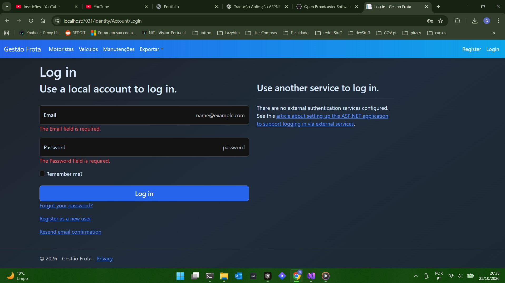
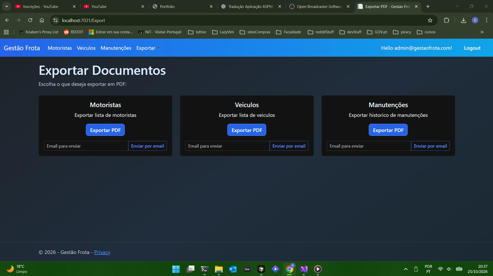
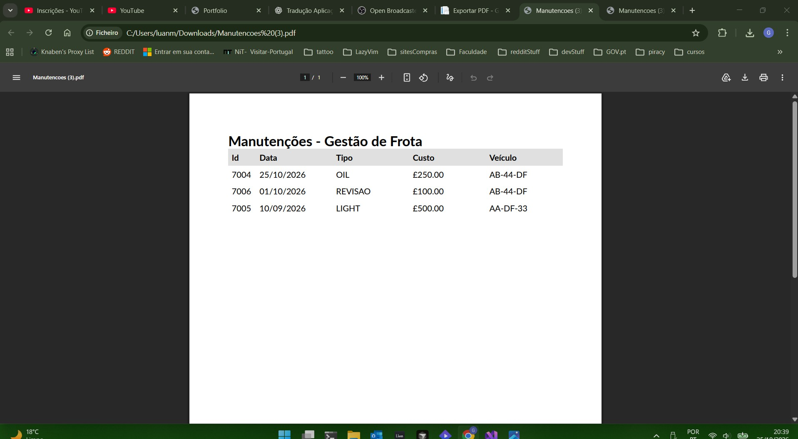

ASP.NET Core MVC app to manage drivers, vehicles, and maintenance records. Role-based access (Admin/User), SQL Server with EF Core migrations, stored procedures, triggers, and PDF exports with optional email delivery.

